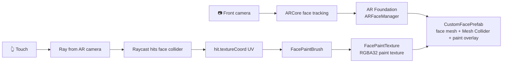

<div align="center">

# 🎨 Face Art Studio

### *AR FaceCanvas: paint on your own face, in real time*

A real-time **augmented reality face-painting app for Android**.<br>
Open the front camera, pick a colour, and paint directly on your face. The paint sticks to the tracked 3D face mesh and follows your head as you move.

<br>


[](https://github.com/Deepanjali15/Face-Art-Studio/releases/latest)
[](https://github.com/Deepanjali15/Face-Art-Studio/releases)
[](https://github.com/Deepanjali15/Face-Art-Studio/stargazers)
[](LICENSE)


<br>

[⬇️ **Download APK**](https://github.com/Deepanjali15/Face-Art-Studio/releases/latest) &nbsp;•&nbsp;
[✨ Features](#-features) &nbsp;•&nbsp;
[⚙️ How it works](#️-how-it-works) &nbsp;•&nbsp;
[🛠️ Run from source](#️-run-it-from-source) &nbsp;•&nbsp;
[👥 Team](#-team)

</div>

---

> 🎓 Course project for *21CSE353T – Augmented, Virtual and Mixed Reality*, B.Tech Computer Science and Engineering, SRM Institute of Science and Technology, Kattankulathur.

## 📥 Download

Grab the latest APK from the [**Releases page**](https://github.com/Deepanjali15/Face-Art-Studio/releases/latest) and install it on an Android phone.

> [!IMPORTANT]
> The phone must support **ARCore Augmented Faces** (front-camera face tracking). Check the [ARCore supported devices list](https://developers.google.com/ar/devices). Not every ARCore phone supports it.

## 📸 Screenshots

<!-- Add your screenshots to a docs/ folder, then delete this comment markers and keep the table.

<div align="center">

| Painting on a face | Colour palette and controls | Saved artwork |
|:---:|:---:|:---:|
|  |  |  |

</div>

Tip: a short GIF of you painting and moving your head (docs/demo.gif) shows the "paint follows the face" effect better than anything else.

<div align="center"></div>
-->

## ✨ Features

| | Feature |
|:---:|---|
| 👤 | Real-time face detection and tracking through the front camera (one face) |
| 🖌️ | Freehand painting by touch, mapped through the face mesh UV coordinates |
| 🎨 | Colour palette with **Small / Medium / Large** brush presets |
| 🧽 | Eraser, Paint mode and **Clear All** |
| 🎯 | Paint stays aligned with the face while you move your head |
| 🔄 | Paint is kept and restored when tracking is lost and the face comes back |
| 💾 | **Save Artwork**: captures the camera view with the UI hidden and saves a PNG to the gallery (album "Face Art Studio") |
| 🧪 | Developer tools: face wireframe overlay and debug HUD (tracking state, FPS, vertex count) |

## ⚙️ How it works



1. **Tracking:** ARCore supplies the face mesh; AR Foundation exposes it as an `ARFace`.
2. **Overlay:** a separate transparent mesh copies the tracked face mesh, so unpainted areas show the real camera image.
3. **Touch to UV:** a camera ray hits the face's Mesh Collider, and the hit's UV coordinate is the position on the paint texture.
4. **Painting:** the brush updates pixels in a runtime transparent texture. Strokes are interpolated between UV points so fast movement draws a continuous line.
5. **Recovery:** the paint pixels are stored when the face is lost and restored when the face is tracked again.

## 📜 Scripts

All scripts are in `Assets/Scripts/FacePainting/`.

<details>
<summary><b>Click to expand the script table</b></summary>

<br>

| Script | Purpose |
|---|---|
| `FaceTrackingManager` | Listens to `ARFaceManager`, keeps the current face, fires face found / lost events |
| `FaceSmoothing` | Smooths the position and rotation of an anchor that follows the face |
| `FaceMeshOverlay` | Copies the tracked face mesh onto the paint overlay, with a small surface offset |
| `FaceColliderSync` | Keeps the Mesh Collider in sync with the updating face mesh |
| `FacePaintInput` | Reads touch input, raycasts onto the face, forwards UV coordinates |
| `FacePaintBrush` | Colour, brush size, paint/erase mode, clear, save and restore of paint pixels |
| `FacePaintTexture` | Owns the runtime paint texture and material; paint, erase, clear |
| `FacePaintUI` | Hooks UI buttons and the brush-size slider to the brush |
| `SaveArtwork` | Hides the UI, captures a screenshot and saves it to the gallery |
| `FaceWireframe` | Debug wireframe of the tracked face mesh |
| `FaceDebugHUD` | Debug text: tracking state, FPS, vertex count |
| `UvChecker`, `UvTemplateExporter` | Helpers for inspecting the face mesh UV layout and exporting a UV template PNG |

</details>

## 🧰 Tech stack

<div align="center">


</div>

- [NativeGallery](https://github.com/yasirkula/UnityNativeGallery) for saving images to the Android gallery

## 🛠️ Run it from source

1. Install **Unity 6000.6.8f1** through Unity Hub, with **Android Build Support** (SDK, NDK, OpenJDK).
2. Clone the repo. It uses Git LFS for large binary assets, so install [Git LFS](https://git-lfs.com/) first.
   ```bash
   git lfs install
   git clone https://github.com/Deepanjali15/Face-Art-Studio.git
   ```
3. Open the project folder in Unity Hub and let it import.
4. Open the main scene (the `FaceStudio` scene in `Assets/Scenes`).
5. Go to **File > Build Settings**, switch the platform to **Android**.
6. In **Project Settings > XR Plug-in Management**, make sure **ARCore** is enabled for Android.
7. Connect an ARCore face-tracking capable phone with USB debugging on, then **Build And Run**.

> [!NOTE]
> The app does not run in the Unity Editor. It needs a real device with front-camera face tracking.

## 🧪 Testing

Tested on a **Samsung Galaxy S23 Ultra**. Observed in one diagnostic session:

| Metric | Reading |
|---|---|
| Frame rate | ~26 FPS |
| Face-mesh vertices | 468 |

That is a single reading, not a benchmark, and results will vary by device and lighting.

## ⚠️ Known limitations

- Needs a phone that supports ARCore Augmented Faces
- Tested on one device only
- Tracking quality depends on lighting and face position; extreme head turns can interrupt tracking
- No in-app gallery, undo/redo, symmetry, layers or paint templates yet
- Saved artwork goes to the phone gallery; there is no in-app viewer

## 🚀 Future work

- [ ] Gallery and sharing
- [ ] Brush opacity and more brush styles
- [ ] Custom colour picker
- [ ] Undo / redo
- [ ] Symmetry drawing
- [ ] Performance profiling on more devices

## 👥 Team

<div align="center">

| | |
|:---:|:---:|
| **Deepanjali Singh** | **KVSL Geetika Reddy** |

</div>

## 🙏 Credits and license

- [NativeGallery](https://github.com/yasirkula/UnityNativeGallery) by Yasin Kula (used for saving to the gallery)
- Unity, AR Foundation and Google ARCore documentation and samples

See the [LICENSE](LICENSE) file for this project's license.

<div align="center">

<br>

⭐ If you like this project, give it a star!

</div>
